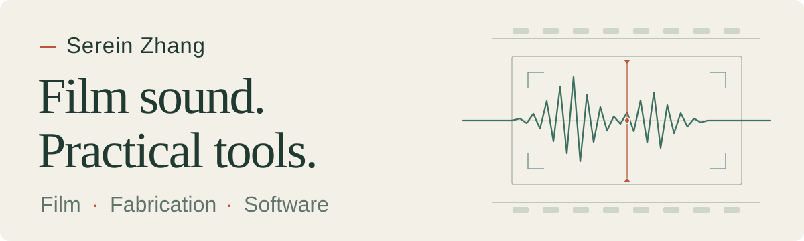

<picture>
  <source media="(prefers-color-scheme: dark)" srcset="assets/hero-dark.svg">
  <source media="(prefers-color-scheme: light)" srcset="assets/hero-light.svg">
  
</picture>

### 从声音出发，把想法做出来。

主要做影视声音，也把工作里遇到的问题延伸成数字制作和软件工具。这里记录我的实践：从具体需求出发，做出原型，再在实际使用中迭代。

*I work in film sound and explore digital fabrication and software through the needs of creative work.*

 

| 01 / FILM SOUND | 02 / FABRICATION | 03 / SOFTWARE |
| :--- | :--- | :--- |
| **影视声音** | **数字制作** | **实用工具** |
| 现场录音、声音编辑与后期流程。关注声音如何服务画面和叙事。 | 从 CAD 到 3D 打印，围绕设备和日常使用制作原型，反复检查尺寸与配合。 | 围绕音频工作流、自动化和设备协作做小工具，把重复的操作变得更顺手。 |

 

### 工作方式 / Working approach

**实际需求 → 小步制作 → 验证 → 迭代。**

工具要经得起真实使用。设计和代码会借助 AI 协作；需求判断、试用反馈与持续调整是实践的一部分。

 

<b>公开实验与探索 / Public experiments</b>

 

- **[SentientTrade](https://github.com/Serein-Zhang/SentientTrade)** · 早期 Python 实验，尝试行情数据处理、基础分类与桌面界面。
- **[Aqara integration fork](https://github.com/Serein-Zhang/ha-aqara-devices-V3-Fork)** · 用于探索 Home Assistant 设备集成的个人 Fork；原项目来自 [Darkdragon14](https://github.com/Darkdragon14/ha-aqara-devices)。

---

Film first. Build with purpose. Refine through use.
